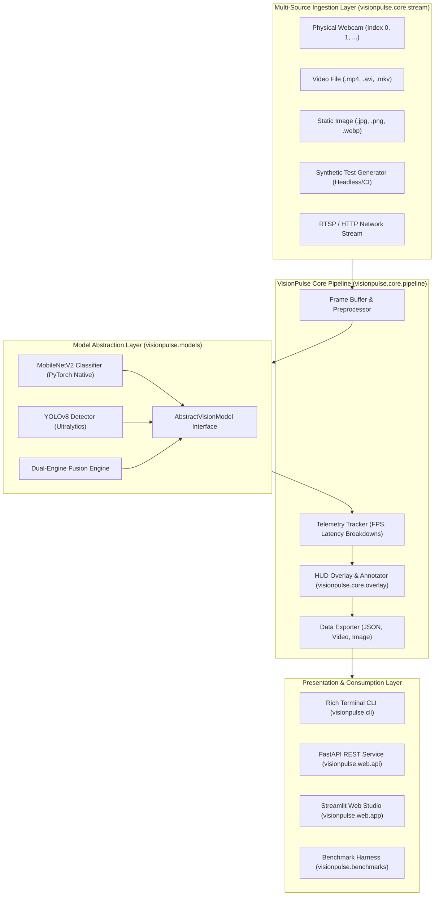
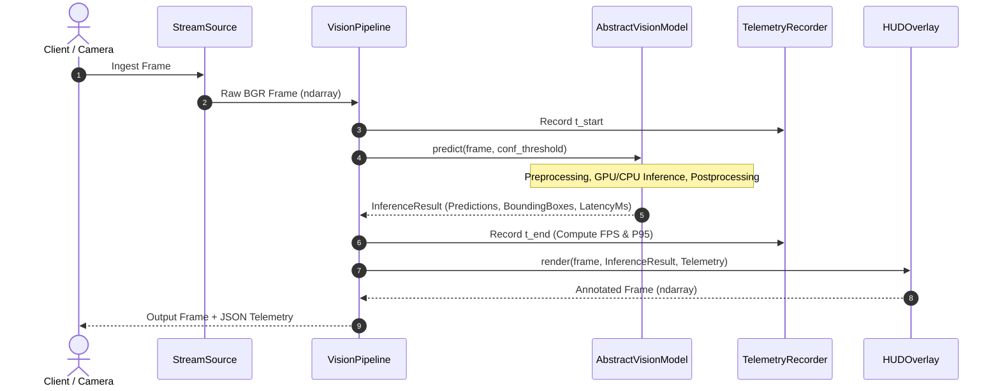

# Architecture Specification: VisionPulse

**System Name:** VisionPulse Dual-Engine Cognitive Vision Platform  
**Architect:** Daniel Richard Xavier  
**Version:** 2.0.0  
**Status:** Production-Ready  

---

## 1. Architectural Overview

VisionPulse decouples perception models, video ingestion, telemetry diagnostics, and user interfaces into an enterprise-grade modular architecture. It supports unified dual-engine inference:
1. **Dense Semantic Classification:** MobileNetV2 (PyTorch/ImageNet-1k) evaluating whole-scene feature representations.
2. **Multi-Object Spatial Localization:** YOLOv8n (Ultralytics/COCO) predicting spatial coordinates, class labels, and confidence bounding boxes.
3. **Dual-Engine Fusion:** Cross-validating classification predictions against localized object detections for enhanced cognitive context.

---

## 2. High-Level System Architecture

---

## 3. Data Flow & Inference Pipeline

---

## 4. Component Structure & Responsibilities

### 4.1 `visionpulse.models`
- **`base.py`**: Defines standard contracts (`AbstractVisionModel`), data schemas (`InferenceResult`, `BoundingBox`, `ClassificationPrediction`, `TelemetryData`), and device resolution logic (`cpu`, `cuda`, `mps`).
- **`mobilenet.py`**: PyTorch-native implementation of MobileNetV2 with ImageNet-1k weights. Evaluates Top-K ranked categories, Softmax normalized confidence percentages, and executes on CPU or CUDA.
- **`yolo.py`**: Ultralytics YOLOv8 detector wrapper. Configurable confidence thresholds, IOU thresholds, non-maximum suppression (NMS), object counts, and bounding box normalization.
- **`ensemble.py`**: Fusion engine combining global classification with spatial multi-object localization, generating scene context summaries.

### 4.2 `visionpulse.core`
- **`stream.py`**: Robust input abstraction. Handles webcams, static image files, video files, and a synthetic animated frame generator that allows automated testing on headless servers without physical cameras.
- **`pipeline.py`**: Thread-safe frame processor integrating model inference, telemetry tracking, and visual annotation.
- **`overlay.py`**: Modern HUD graphics engine. Draws glassmorphic telemetry cards, semi-transparent bounding boxes, color-coded class badges, and real-time FPS/latency meters.
- **`exporter.py`**: Telemetry and frame logging to JSON files, annotated images, and MP4 video recordings.

### 4.3 `visionpulse.benchmarks`
- **`evaluator.py`**: Comprehensive benchmarking harness measuring inference latency distributions (P50, P90, P99), throughput (FPS), memory footprint, and detection accuracy.
- **`test_dataset.py`**: Curated test image generation and ground truth validation for regression testing.

### 4.4 `visionpulse.web`
- **`api.py`**: FastAPI REST server providing OpenAPI/Swagger endpoints for classification, object detection, and health checks.
- **`app.py`**: Streamlit interactive Web Studio providing live camera processing, image upload analysis, side-by-side model comparisons, and interactive telemetry charts.

---

## 5. Security & Reliability Patterns

1. **Graceful Degradation:** If CUDA is unavailable, the pipeline smoothly defaults to optimized multi-threaded CPU inference.
2. **Headless Execution Guard:** GUI window calls (`cv2.imshow`) are wrapped in display availability checks, preventing fatal crashes in CI/CD and Docker environments.
3. **Structured Telemetry:** All inference results include microsecond-precision timestamps and execution durations for latency monitoring.
4. **Input Sanitization:** Image uploads are validated against dimension constraints and supported formats (JPEG, PNG, WebP) to prevent memory exhaustion attacks.
